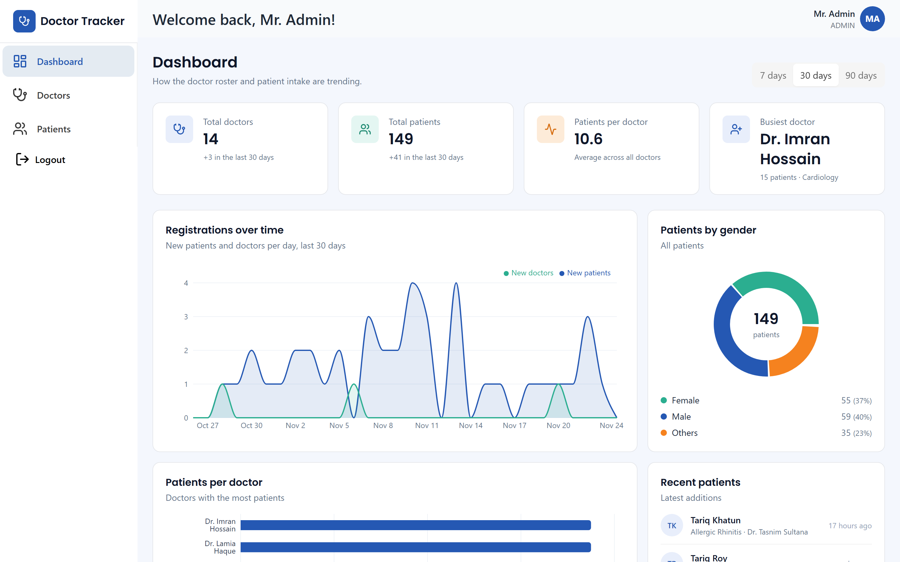
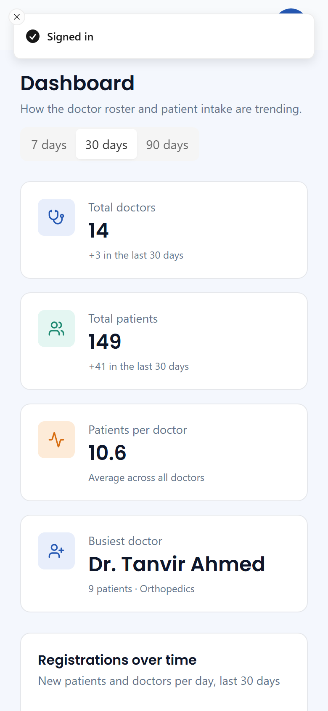

# Doctor Tracker – Admin Portal

Next.js client for **Doctor Tracker**. Pair it with the Express API in `doctor-tracker-backend`.

## Description

Doctor Tracker is a secure admin portal for managing doctors and their patients. Administrators sign in, keep the doctor roster, add and remove patients under each doctor, edit patients from a dedicated page, and watch intake trends on a dashboard. Every list is server-paginated with search and filters (date range, specialization, hospital, condition, gender), and the UI is responsive from phone to desktop.

## Setup Guide

Requirements: Node.js 20+, the backend running (see its README).

```bash
npm install
cp .env.example .env.local
#   NEXT_PUBLIC_API_URL=http://localhost:8080/api/v1   (must include /api/v1; match the backend PORT)
npm run dev          # http://localhost:3000
```

Sign in with the admin the backend creates on first boot (`admin@gmail.com` / `123456` by default; set `Admin_Email` / `Admin_Password` in the backend `.env`).

### Demo mode (no backend)

```bash
NEXT_PUBLIC_DEMO=true npm run dev     # sign in: admin@demo.com / demo1234
```

All requests are answered in the browser by `src/lib/demo/demoApi.ts` (14 doctors, 150 patients, same filters, sorting, pagination, analytics and validation errors as the API). Data is kept in `localStorage`, so edits survive a reload; clear site data to reset. It is lazy-loaded and never used unless the flag is `true`. Handy for a static Vercel preview.

Other scripts: `npm run build` · `npm run start` · `npm run typecheck` · `npm run lint`.

`.env.example`:

```
NEXT_PUBLIC_API_URL=http://localhost:8080/api/v1
```

### Deploy

Vercel or Netlify: set `NEXT_PUBLIC_API_URL` to your deployed API (`https://<api-host>/api/v1`), and set the backend's `FRONTEND_URL` to the deployed frontend URL (CORS).

## System Architecture

```
Browser ─▶ Next.js (App Router, middleware guards /dashboard/*) ─▶ Redux Toolkit store
                                                                     └─ RTK Query ──REST──▶ Express API ─▶ MongoDB
```

- `src/middleware.ts` redirects visitors without an admin token away from `/dashboard/*`.
- `src/redux/api/baseApi.ts` attaches the access token, refreshes it on `401` and retries once.
- `src/redux/service/admin/{doctor,patient,analytics}Api.ts` hold typed endpoints and cache tags.
- Pages: `/dashboard` (analytics), `/dashboard/doctors`, `/dashboard/doctors/[id]` (doctor + patients), `/dashboard/patients`.
- Shared UI lives in `src/components/doctor-tracker` (tables, filter bar, modals, charts); list state in `src/hooks/useListParams.ts`.

## Technical Decisions

**1. RTK Query for server state, tag-based invalidation, and no duplicated store.**
Doctors, patients and analytics are server data, so they live in RTK Query's cache rather than hand-written slices. Each query provides tags (`doctor:LIST`, `patient:DOCTOR-<id>`, `analytics`) and each mutation invalidates exactly what it changes: adding a patient refreshes that doctor's list and count, the global patient list and the dashboard, while nothing else refetches. This removes manual refetch calls, and Redux already holds the auth session, so the cache shares one store with it. Trade-off: tag design needs care, and moving a patient between doctors invalidates whole tag types because several per-doctor lists change at once.

**2. Server-driven lists with one hook for query state.**
Pagination, search, filters and sorting are executed in MongoDB, never in the browser, so the page cost stays flat as data grows. `useListParams` owns the query string state: any filter, search or sort change resets to page 1, search is debounced, and after a delete it steps back to the last valid page. Tables, filter bar and charts are memoised (`memo`, stable callbacks) so typing in search does not re-render charts, and Recharts components receive already-shaped data from the API.

## Visual Evidence

Add screenshots to `docs/screenshots/` and reference them here:

| View          | Desktop                                      | Mobile                                      |
| ------------- | -------------------------------------------- | ------------------------------------------- |
| Dashboard     | `docs/screenshots/dashboard-desktop.png`     | `docs/screenshots/dashboard-mobile.png`     |
| Doctors       | `docs/screenshots/doctors-desktop.png`       | `docs/screenshots/doctors-mobile.png`       |
| Doctor detail | `docs/screenshots/doctor-detail-desktop.png` | `docs/screenshots/doctor-detail-mobile.png` |
| Patients      | `docs/screenshots/patients-desktop.png`      | `docs/screenshots/patients-mobile.png`      |



